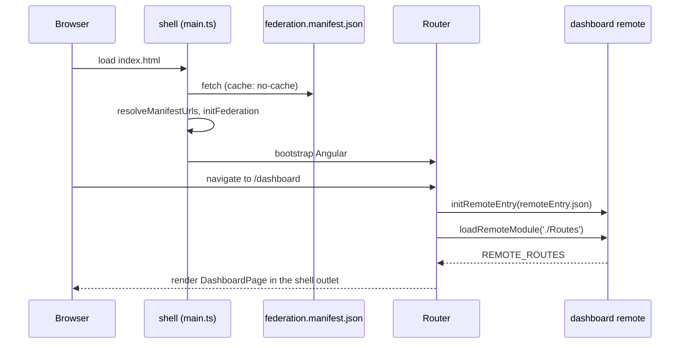

# Architecture

Technical reference for this repository: how the shell composes the remotes at runtime, what is shared and why, how failures are contained, and how the build is deployed. For a short overview see [README.md](README.md); to rebuild the repository from scratch see [SETUP-GUIDE.md](SETUP-GUIDE.md).

## Why Native Federation

Angular's default builder is `@angular/build:application`: esbuild for builds, Vite for the dev server. Classic Module Federation is a webpack plugin and depends on webpack's chunk-loading runtime, so it does not run under this builder.

[Native Federation](https://native-federation.com/) (`@angular-architects/native-federation`) gets the same result with browser standards:

- Every shared package and exposed module is an **ES module**.
- An **import map** tells the browser which URL serves each bare specifier (`@angular/core`, `@client-portal/shared/ui`, ...). [`es-module-shims`](https://github.com/guybedford/es-module-shims) polyfills import maps where needed and allows changing them at runtime.
- The adapter wraps the Angular builder instead of replacing it, so `ng build` features (budgets, assets, output hashing) keep working.

## Projects

| Project          | Type                 | Port   | Tags                          | Selector prefix | Exposes                                             |
| ---------------- | -------------------- | ------ | ----------------------------- | --------------- | --------------------------------------------------- |
| `shell`          | Dynamic host         | `4200` | `type:app`, `scope:shell`     | `shl`           | nothing                                             |
| `dashboard`      | Remote               | `4201` | `type:app`, `scope:dashboard` | `dsh`           | `./Routes` → `src/app/remote-entry/entry.routes.ts` |
| `reports`        | Remote               | `4202` | `type:app`, `scope:reports`   | `rpt`           | `./Routes` → `src/app/remote-entry/entry.routes.ts` |
| `ui`             | Library (Angular)    | n/a    | `type:ui`, `scope:shared`     | `ui`            | `Page`, `SectionHeading`, `DemoBadge`               |
| `demo-contracts` | Library (no Angular) | n/a    | `type:util`, `scope:shared`   | n/a             | `DEMO_BRAND`                                        |

Every remote also runs on its own: `pnpm start:dashboard` serves the dashboard at `http://localhost:4201/dashboard`, using the same routes the shell mounts.

## Runtime flow



1. `apps/shell/src/main.ts` fetches `federation.manifest.json` with `cache: 'no-cache'`, so a changed remote URL takes effect on the next page load instead of after the host's cache lifetime.
2. `resolveManifestUrls` (`apps/shell/src/manifest-urls.ts`) resolves relative entries against `document.baseURI`, so one manifest works on any origin.
3. `initFederation({}, { hostRemoteEntry })` builds the import map from the shell's own `remoteEntry.json`. It registers no remotes, so startup fetches no remote code.
4. `bootstrap(nf, manifest)` starts Angular and passes the federation runtime and the manifest to the routes.
5. On the first navigation to a remote, its route calls `nf.initRemoteEntry(url, name)` and then `loadRemoteModule(name, './Routes')`, and mounts the returned `REMOTE_ROUTES`.

The remotes' `main.ts` call `initFederation` the same way and import `./bootstrap` only after it succeeds, because their Angular imports resolve through that import map.

## The manifest

`apps/shell/public/federation.manifest.json` maps each remote name to its `remoteEntry.json`:

```json
{
  "dashboard": "http://localhost:4201/remoteEntry.json",
  "reports": "http://localhost:4202/remoteEntry.json"
}
```

- Keys must equal the `name` in each remote's `federation.config.mjs`.
- The file is a static asset, so one shell build can point at different remotes per environment by serving a different manifest. No rebuild is needed.
- `nx build shell` copies this development manifest (`localhost` URLs) into `dist/`. Replace it at deploy time; `pnpm build:gh-pages` does that.
- An entry can also be an object, `{ "url": "...", "integrity": "sha384-..." }`. The shell then passes the integrity hash to `initRemoteEntry`.

## The remote registry

`apps/shell/src/app/remotes.ts` lists the remotes the shell offers (`name`, `label`, `description`). Three things are generated from that list: the routes in `app.routes.ts`, the header navigation in `app.html` and the cards on the home page. To add a remote to the shell, add one entry there and its URL to the manifest.

## Sharing

Each `federation.config.mjs` declares the same sharing rules, so the shell and both remotes agree on one copy of each shared package.

### npm packages: `shared`

```javascript
shared: fromPackageJson({
  singleton: true,
  strictVersion: true,
  requiredVersion: 'auto',
})
  .skip(['rxjs/ajax', 'rxjs/fetch', 'rxjs/testing', 'rxjs/webSocket'])
  .patch(['@angular/*'], {
    includeSecondaries: { keepAll: true },
  }),
```

- `fromPackageJson` shares every dependency in the root `package.json`.
- `singleton: true` loads one instance at runtime. Angular needs this: two copies of `@angular/core` mean two injector trees and broken DI.
- `strictVersion: true` with `requiredVersion: 'auto'` fails loudly on a version mismatch instead of loading a second copy.
- `.skip([...])` drops RxJS entry points the apps never import.
- `.patch(['@angular/*'], { includeSecondaries: { keepAll: true } })` shares every secondary entry point (`@angular/common/http`, ...) along with its package.

All apps install from one lockfile and deploy together, so the versions always match. The checks catch drift if a remote is ever deployed on its own.

### Workspace libraries: `sharedMappings`

```javascript
sharedMappings: mappingsFromWorkspace({
  singleton: true,
  strictVersion: true,
}).only(['@client-portal/shared/demo-contracts', '@client-portal/shared/ui']),
```

`mappingsFromWorkspace` reads the `paths` in `tsconfig.base.json`; `.only([...])` limits sharing to the two libraries. No private npm registry is involved: the libraries are built into the federation output and loaded once at runtime.

The shell imports neither library, so its build logs `No shared mapping is reachable from the entry points`. That warning is expected.

### `features`

The `init` schematic generates a `features` block (`denseChunking`, `denseExternals`, `strictImports`). It is kept as generated; see the [configuration docs](https://native-federation.com/docs/v4/angular-adapter/configuration/).

## Fault isolation

A failing remote never takes the shell down.

| Failure                                      | What the user sees                                                                                                                               |
| -------------------------------------------- | ------------------------------------------------------------------------------------------------------------------------------------------------ |
| A remote is offline at startup               | Nothing. Remotes register lazily, so the shell starts normally.                                                                                  |
| A remote fails to load on navigation         | `withNavigationErrorHandler(redirectToRemoteUnavailable)` redirects to `/remote-unavailable?from=<url>` with **Try again** and **Back to home**. |
| The remote comes back                        | **Try again** or the next visit loads it. The router caches only successful lazy loads, so no page reload is needed.                             |
| `federation.manifest.json` cannot be fetched | Angular cannot start without the import map, so `main.ts` renders a plain-DOM "Client Portal could not start" message instead of a blank page.   |

The retry button accepts only same-app absolute paths from the `from` query parameter (`/…`, not `//…`), so the page cannot be used as an open redirect.

```typescript
// apps/shell/src/app/app.routes.ts
const loadRemoteRoutes = (remoteName: string) => async () => {
  const entry = manifest[remoteName];
  if (!entry) {
    throw new Error(`Remote '${remoteName}' is not listed in federation.manifest.json`);
  }
  await (typeof entry === 'string'
    ? nf.initRemoteEntry(entry, remoteName)
    : nf.initRemoteEntry(entry.url, { name: remoteName, integrity: entry.integrity }));
  return loadRoutes(remoteName);
};
```

## Module boundaries

`@nx/enforce-module-boundaries` (root `eslint.config.mjs`) checks every import against two tag dimensions. A violation fails `pnpm lint:all`, the pre-commit hook and CI.

| Type           | May depend on                          |
| -------------- | -------------------------------------- |
| `type:app`     | `type:feature`, `type:ui`, `type:util` |
| `type:feature` | `type:ui`, `type:util`                 |
| `type:ui`      | `type:ui`, `type:util`                 |
| `type:util`    | `type:util`                            |

| Scope             | May depend on                     |
| ----------------- | --------------------------------- |
| `scope:shell`     | `scope:shell`, `scope:shared`     |
| `scope:dashboard` | `scope:dashboard`, `scope:shared` |
| `scope:reports`   | `scope:reports`, `scope:shared`   |
| `scope:shared`    | `scope:shared`                    |

- **Type** keeps dependencies pointing down the layers: a UI component never imports a feature.
- **Scope** keeps each app's code private. The shell cannot import remote code at build time; it reaches remotes only at runtime through federation, which keeps them independently buildable.

Feature code lives inside the apps today (`apps/<remote>/src/app/features/`). If it moves into a library, tag it `type:feature` plus the remote's scope. A new project without tags fails lint until it is tagged.

Madge (`pnpm check:circular`) complements this: module boundaries govern imports between projects, Madge catches import cycles between files.

## Styling and accessibility

- A remote's global stylesheet is not loaded when the shell hosts it. Shared visuals therefore live in components with their own styles (`libs/shared/ui`), not in a global stylesheet.
- The Inter variable font is self-hosted through `@fontsource-variable/inter`, loaded from `styles.scss` in the shell and in each remote (for standalone runs).
- Every route sets a page title (`Client Portal · Dashboard`). The shell route's title also covers the remote's own untitled routes.
- After each in-app navigation, `App` in the shell moves focus to the new page's `h1` (`tabindex="-1"`), so keyboard and screen reader users land on the new page.
- Text colours meet WCAG AA contrast.

## Testing

- Jest 30 with `jest-preset-angular`, zoneless test environment (`setupZonelessTestEnv` in each `src/test-setup.ts`).
- Per-project configs are plain CommonJS (`jest.config.cjs`). Jest compiles a `jest.config.cts` with ts-node, which fails under TypeScript 6.
- `demo-contracts` has no specs yet and sets `passWithNoTests: true`.
- Strict template type checking runs only in the Angular compiler, so `pnpm build:all` is part of `check:all` and CI.

## Builds and deployment

`pnpm build:all` builds each app into `dist/apps/<app>/browser`. Each remote's output contains its `remoteEntry.json`.

### GitHub Pages

`pnpm build:gh-pages` (`tools/scripts/build-gh-pages.mjs`) produces one deployable tree in `dist/gh-pages/`:

```text
dist/gh-pages/
├── index.html, main-*.js, ...   shell, base href /angular-nx-native-federation/
├── federation.manifest.json     production manifest (relative entries)
├── 404.html                     copy of index.html (SPA fallback)
├── .nojekyll
└── remotes/
    ├── dashboard/               base href /angular-nx-native-federation/remotes/dashboard/
    └── reports/                 base href /angular-nx-native-federation/remotes/reports/
```

1. Clears `node_modules/.cache/native-federation` (avoids stale path casing on Windows).
2. Builds each remote with `--base-href=<BASE_HREF>remotes/<name>/`, then the shell with `--base-href=<BASE_HREF>`.
3. Copies the outputs into the tree above.
4. Writes a manifest with relative entries (`remotes/dashboard/remoteEntry.json`), so the bundle works on any origin.
5. Adds `.nojekyll`; without it GitHub Pages hides files that start with `_` (`_angular_*.js`).
6. Copies `index.html` to `404.html`, so deep links such as `/dashboard` load the app. GitHub Pages serves that file with status 404: users see the page, crawlers and uptime monitors see a 404. A host with real SPA rewrites avoids this.

`BASE_HREF` (default `/angular-nx-native-federation/`) changes the deploy path; it must start and end with `/`.

### CI

`.github/workflows/deploy.yml` runs on pushes and pull requests to `master` and on manual runs:

- **verify**: `pnpm install --frozen-lockfile`, `format:check`, `lint:all`, `test:all`, `check:circular`, `build:all`.
- **deploy** (only on `refs/heads/master`, after `verify`): `pnpm build:gh-pages`, upload `dist/gh-pages` (with hidden files, to keep `.nojekyll`), deploy to GitHub Pages.

Actions are pinned to commit SHAs; Dependabot keeps them and the npm packages up to date.

### Production hosting outside GitHub Pages

Each app can be deployed to its own origin. The shell's manifest then lists absolute URLs:

```json
{
  "dashboard": "https://dashboard.example.com/remoteEntry.json",
  "reports": "https://reports.example.com/remoteEntry.json"
}
```

Such a host must also provide:

- CORS headers on the remotes' files.
- An SPA fallback (serve `index.html` for unknown paths).
- A short cache lifetime for `remoteEntry.json` and `federation.manifest.json`, and long-lived caching for hashed bundles.
- HTTPS.

## AI agent configuration

The repository ships configuration for several AI coding agents. Nx generates part of it and writes the same skills into each agent's folder, so `.agents/skills/` and `.github/skills/` are identical on purpose. Don't edit generated files by hand: refresh them with `pnpm nx configure-ai-agents` and check them with `pnpm nx configure-ai-agents --check=all`.

| Path                                                                                            | Maintained by                                                                     |
| ----------------------------------------------------------------------------------------------- | --------------------------------------------------------------------------------- |
| `AGENTS.md` (between the `nx configuration` markers), `.agents/`, `.github/skills/`, `.gemini/` | Nx (`nx configure-ai-agents`)                                                     |
| `.github/agents/`, `.github/prompts/`                                                           | Nx (CI monitor agent and prompt)                                                  |
| `.claude/settings.json`                                                                         | Project: enables the Nx Claude plugin and sets permissions                        |
| `CLAUDE.md`, `.claude/skills/`                                                                  | Project: third-party skills in `.claude/skills/` are pinned in `skills-lock.json` |

## References

- [Native Federation for Angular](https://native-federation.com/docs/v4/angular-adapter/): [configuration](https://native-federation.com/docs/v4/angular-adapter/configuration/), [builder](https://native-federation.com/docs/v4/angular-adapter/builder/), [runtime](https://native-federation.com/docs/v4/angular-adapter/runtime/), [schematics](https://native-federation.com/docs/v4/angular-adapter/schematics/)
- [Angular build system](https://angular.dev/tools/cli/build-system)
- [Import maps (MDN)](https://developer.mozilla.org/en-US/docs/Web/HTML/Reference/Elements/script/type/importmap)
- [Nx: enforce module boundaries](https://nx.dev/docs/features/enforce-module-boundaries)
- [Nx: migrating Angular Module Federation](https://nx.dev/docs/kb/migrate-angular-module-federation)
