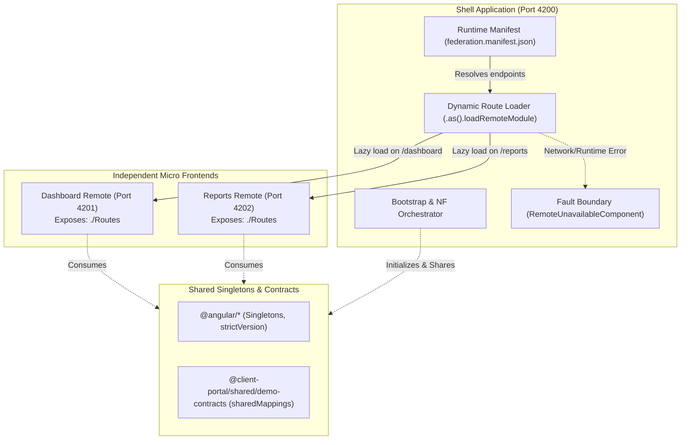
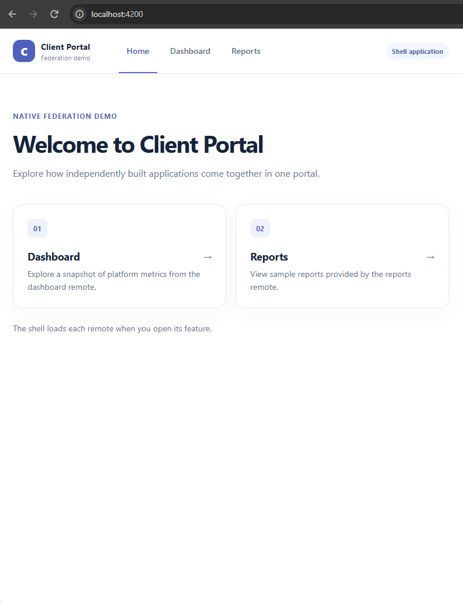
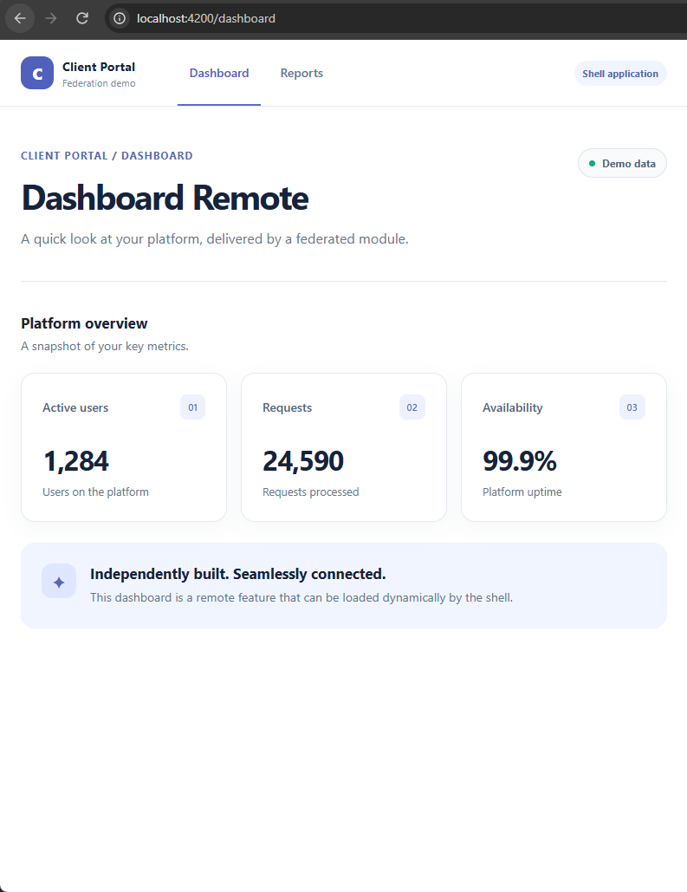
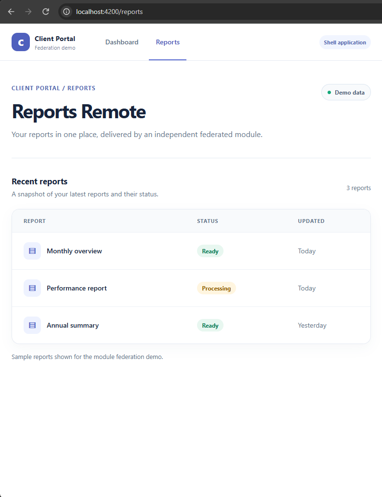
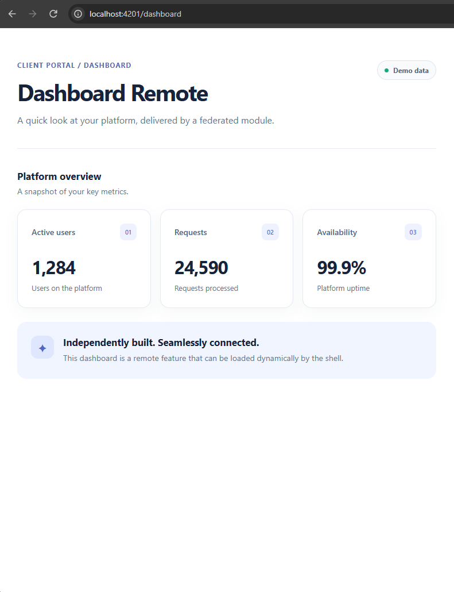
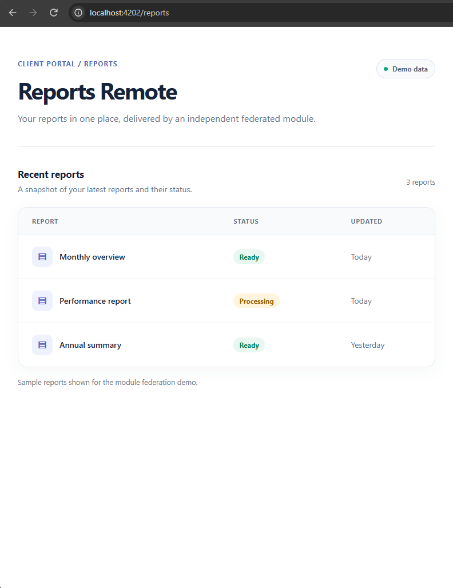

# Angular + Nx + Native Federation

<p align="center">
  
  &nbsp;&nbsp;&nbsp;&nbsp;
  
</p>

<p align="center">
  <strong>Enterprise Reference Architecture for Browser-Native Micro Frontends</strong><br />
  <em>Demonstrating the power of Native Federation with Angular, Nx, esbuild, and Vite.</em>
</p>

<p align="center">
  
  
  
  
  
  
  
  
  
</p>

---

## Architectural Overview

Modern Angular has transitioned to the official **Application Builder** (`@angular/build:application`), pairing **esbuild** for high-performance builds with **Vite** for local development. However, classical Webpack Module Federation relies on Webpack compiler internals, chunk-loading runtimes, and tapable hooks that cannot operate under an esbuild pipeline.

**Native Federation** (`@angular-architects/native-federation`) solves this paradigm shift by utilizing standard browser-native mechanisms:

1. **ECMAScript Modules (ESM)** as the universal module format.
2. **Import Maps** (polyfilled where needed via `es-module-shims`) for dynamic runtime dependency redirection.
3. **Bundler Agnosticism**: Seamless integration with Angular's official esbuild builder without Webpack wrappers or custom plugin hacks.

This repository serves as a production-hardened reference implementation demonstrating how an enterprise Nx monorepo hosts independently deployable Micro Frontends, isolates runtime fault domains, and manages shared library singletons.

---

## System Architecture & Topology



### Application Matrix

| Project              | Type          |  Port  | Route Endpoint                        | Exposed Contract                          |    Standalone Runnable?     |
| :------------------- | :------------ | :----: | :------------------------------------ | :---------------------------------------- | :-------------------------: |
| **`shell`**          | Dynamic Host  | `4200` | `/` (Home), `/dashboard`, `/reports`  | None (Consumer)                           |             Yes             |
| **`dashboard`**      | Remote MFE    | `4201` | `/` (Standalone), `/dashboard` (Host) | `./Routes` (`entry.routes.ts`)            |             Yes             |
| **`reports`**        | Remote MFE    | `4202` | `/` (Standalone), `/reports` (Host)   | `./Routes` (`entry.routes.ts`)            |             Yes             |
| **`demo-contracts`** | Workspace Lib |  N/A   | TypeScript path mapping               | Data contracts (`DEMO_BRAND`, interfaces) | Shared via `sharedMappings` |

---

## Visual Showcase

### 1. Integrated Portal Experience (Shell Orchestration)

The Shell dynamically streams remote entries on navigation without full page reloads, mounting each remote into the Shell layout and navigation bar:

|        Shell Home Landing        |
| :------------------------------: |
|  |

|           Dashboard Remote in Shell           |          Reports Remote in Shell          |
| :-------------------------------------------: | :---------------------------------------: |
|  |  |

### 2. Standalone Execution (Independent Development)

Each remote is a fully sovereign Angular application with its own bootstrap, routing, and dev server, enabling isolated local iteration without running the Shell:

| Standalone Dashboard (`localhost:4201`)  | Standalone Reports (`localhost:4202`) |
| :--------------------------------------: | :-----------------------------------: |
|  |   |

---

## Core Enterprise Highlights

### 1. Dynamic Host with Externalized Manifest

Instead of baking static remote entry URLs into application bundles at compile time, the host fetches `apps/shell/public/federation.manifest.json` at runtime:

```json
{
  "dashboard": "http://localhost:4201/remoteEntry.json",
  "reports": "http://localhost:4202/remoteEntry.json"
}
```

> [!TIP]
> **Zero Rebuild Deployments:** The exact same Shell container image or production build can be promoted across environments (Dev &rarr; Staging &rarr; Production) purely by mounting an environment-specific `federation.manifest.json` or serving it from an edge configuration service.

### 2. Strict Singleton & Version Negotiation

Angular requires single instances of `@angular/core`, `@angular/common`, and the router to prevent injector context fragmentation:

```javascript
// apps/*/federation.config.mjs
shared: fromPackageJson({
  singleton: true,
  strictVersion: true,
  requiredVersion: 'auto',
})
  .skip(['rxjs/ajax', 'rxjs/fetch', 'rxjs/testing', 'rxjs/webSocket'])
  .patch(['@angular/*'], {
    includeSecondaries: { keepAll: true },
  }),
```

### 3. Sharing Monorepo Libraries via `sharedMappings`

Nx workspace libraries defined in `tsconfig.base.json` paths are shared at runtime through `sharedMappings`:

```javascript
sharedMappings: mappingsFromWorkspace({
  singleton: true,
  strictVersion: true,
}).only(['@client-portal/shared/demo-contracts']),
```

This avoids publishing internal packages to a private npm registry while ensuring identical memory instances across host and remotes.

### 4. Fault Domain Isolation & Circuit Breaking

Remote failures do not cascade to crash the Shell. If a remote service goes down, the route loader safely catches the rejection and mounts a resilient fallback component:

```typescript
// apps/shell/src/app/app.routes.ts
{
  path: 'dashboard',
  loadChildren: () =>
    dashboardLoader
      .loadRemoteModule('dashboard', './Routes')
      .then((m) => m.REMOTE_ROUTES)
      .catch((error) => {
        console.error('Dashboard remote failed to load:', error);
        return [{ path: '', component: RemoteUnavailableComponent }];
      }),
}
```

## Setup & Execution Guide

### Prerequisites

- **Node.js**: `v20.x` or `v22.x` (LTS)
- **pnpm**: `v10.x` (`npm install --global pnpm`)
- **Git**

### 1. Installation

Clone the repository and install dependencies using pnpm:

```bash
git clone <repo-url>
cd angular-nx-native-federation
pnpm install
```

### 2. Start Applications (Local Development)

Start the entire microfrontend ecosystem with a single command:

```bash
pnpm start:all
```

This concurrently boots:

- `shell` on `http://localhost:4200`
- `dashboard` on `http://localhost:4201`
- `reports` on `http://localhost:4202`

Alternatively, start applications individually in separate terminals:

```bash
# Terminal 1: Shell
pnpm start:shell        # or: pnpm nx serve shell

# Terminal 2: Dashboard Remote
pnpm start:dashboard    # or: pnpm nx serve dashboard

# Terminal 3: Reports Remote
pnpm start:reports      # or: pnpm nx serve reports
```

### 3. Production Builds

Build all applications in parallel:

```bash
pnpm build:all
```

Or build specific projects with production optimization:

```bash
pnpm nx build shell --configuration=production
pnpm nx build dashboard --configuration=production
pnpm nx build reports --configuration=production
```

The compiled output is located under `dist/apps/<app-name>/browser`, complete with each remote's `remoteEntry.json`.

---

## Code Quality, Verification & DX

| Task                  | Command               | Purpose                                                                |
| :-------------------- | :-------------------- | :--------------------------------------------------------------------- |
| **Test**              | `pnpm test:all`       | Run all unit tests across the workspace via `@angular/build:unit-test` |
| **Lint**              | `pnpm lint:all`       | Lint all projects using ESLint flat config (`eslint.config.mjs`)       |
| **Format Check**      | `pnpm format:check`   | Verify codebase formatting with Prettier                               |
| **Format Write**      | `pnpm format`         | Auto-format uncommitted or all files with Prettier                     |
| **Circular Check**    | `pnpm check:circular` | Audit dependency tree with **Madge** to prevent architectural cycles   |
| **Full Health Check** | `pnpm check:format`   | Comprehensive check: Format + Lint + Tests + Circular Dependencies     |
| **Project Graph**     | `pnpm graph`          | Visualize Nx dependency graph and project boundaries                   |

---

## Step-by-Step Monorepo Construction Reference

If you are reconstructing this architecture from scratch or adopting it in an existing enterprise repository:

1. **Nx Foundation**: Bootstrap an integrated monorepo with `pnpm dlx create-nx-workspace@latest client-portal` choosing Angular, esbuild, SCSS, and ESLint.
2. **Generate Applications**: Generate the host (`shell`) and remotes (`dashboard`, `reports`) via `pnpm nx g @nx/angular:application apps/<name>`.
3. **Workspace Contracts**: Create shared domain libraries via `pnpm nx g @nx/angular:library libs/shared/<name>`.
4. **Install Native Federation**: Install `@angular-architects/native-federation` matching your Angular major release.
5. **Initialize Remotes**: Run `pnpm nx g @angular-architects/native-federation:init --project=<remote> --port=<port> --type=remote`.
6. **Initialize Dynamic Host**: Run `pnpm nx g @angular-architects/native-federation:init --project=shell --port=4200 --type=dynamic-host`.
7. **Configure Sharing**: Define `shared` (package.json singletons) and `sharedMappings` (monorepo paths) in each `federation.config.mjs`.
8. **Expose & Route**: Remotes export `./Routes`; Shell wires dynamic `loadRemoteModule` with resilience boundaries.

> [!NOTE]
> For the exhaustive, line-by-line configuration guide covering every file modification, build target mutation, and production hosting concern, see [setup-guide.md](setup-guide.md).

---

## Official Documentation & References

- [Nx Documentation](https://nx.dev)
- [Angular Builders & esbuild](https://angular.dev/tools/cli/build-system)
- [Native Federation Documentation](https://native-federation.com/)
- [Nx Module Federation Migration Guide](https://nx.dev/docs/kb/migrate-angular-module-federation)
- [Architecture & Setup Deep Dive](setup-guide.md)
