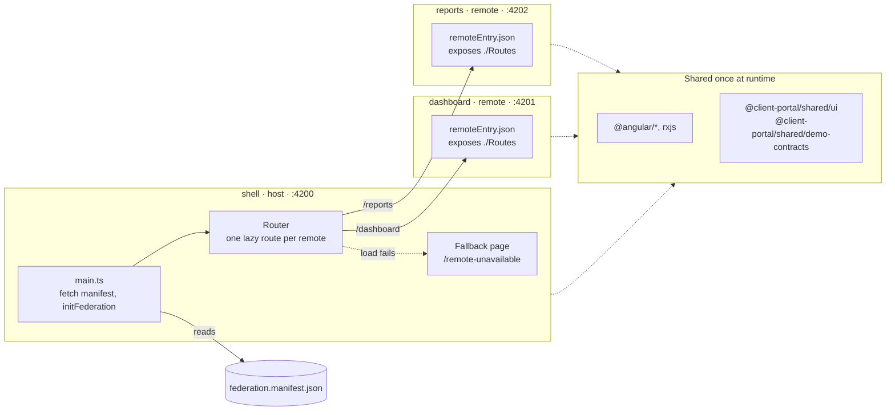
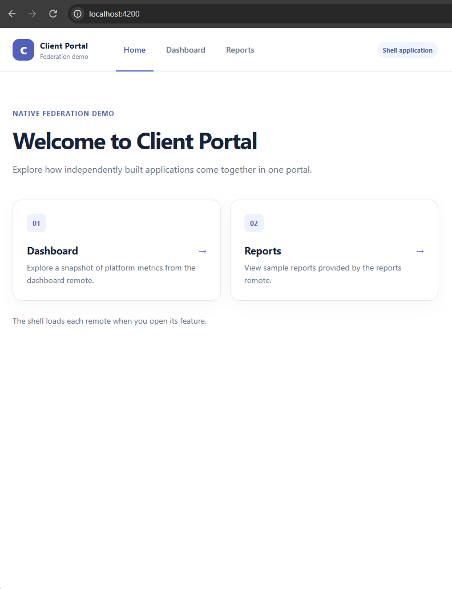
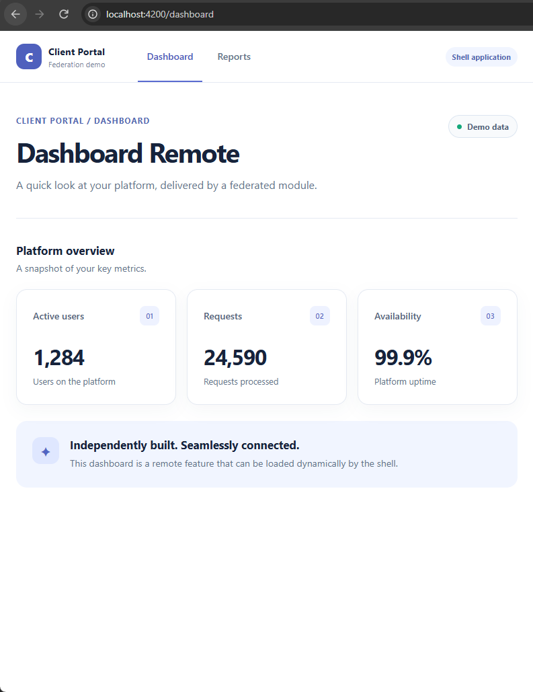
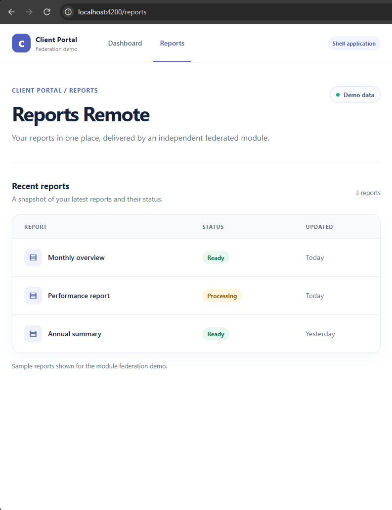

# Angular + Nx + Native Federation

A micro frontend reference project: one Angular shell loads two independently built Angular apps at runtime with [Native Federation](https://native-federation.com/), inside an [Nx](https://nx.dev/) monorepo.

**Live demo:** https://oleh-kazban.github.io/angular-nx-native-federation/

- **Shell** (`:4200`) owns the layout and navigation, and loads each remote on its first visit.
- **Dashboard** (`:4201`) and **Reports** (`:4202`) are remotes. Each one also runs on its own.
- If a remote is down, the shell keeps working and shows a fallback page with **Try again**.

Stack: Angular 22 (zoneless, standalone, signals), `@angular-architects/native-federation` 22, Nx 24, TypeScript 6, Jest 30, pnpm 10.

## Architecture



The shell reads remote URLs from `federation.manifest.json` at runtime, so the same shell build can point at different remotes per environment. Angular and the shared workspace libraries load once and are used by all three apps.

|             Shell             |              Dashboard in the shell               |             Reports in the shell              |
| :---------------------------: | :-----------------------------------------------: | :-------------------------------------------: |
|  |  |  |

## Quick start

Requirements: Node.js `^22.22.3`, `^24.15.0` or `>=26` (`.nvmrc` pins 24) and pnpm 10.

```bash
git clone https://github.com/oleh-kazban/angular-nx-native-federation.git
cd angular-nx-native-federation
pnpm install
pnpm start:all
```

Open http://localhost:4200. The remotes also run standalone at http://localhost:4201 and http://localhost:4202.

## Commands

| Command                                                  | What it does                                                                  |
| -------------------------------------------------------- | ----------------------------------------------------------------------------- |
| `pnpm start:all`                                         | Serve the shell and both remotes in parallel                                  |
| `pnpm start:shell`                                       | Serve the shell on port 4200                                                  |
| `pnpm start:dashboard`                                   | Serve the dashboard remote on port 4201                                       |
| `pnpm start:reports`                                     | Serve the reports remote on port 4202                                         |
| `pnpm build:all`                                         | Production build of all apps into `dist/apps/<app>/browser`                   |
| `pnpm build:shell` / `build:dashboard` / `build:reports` | Production build of one app                                                   |
| `pnpm build:gh-pages`                                    | Build and assemble the GitHub Pages bundle in `dist/gh-pages/`                |
| `pnpm test:all`                                          | Run all Jest tests                                                            |
| `pnpm lint:all`                                          | Lint all projects with ESLint, including module boundary rules                |
| `pnpm lint:affected`                                     | Lint only the projects affected by your changes (used by the pre-commit hook) |
| `pnpm format`                                            | Format all files with Prettier                                                |
| `pnpm format:uncommitted`                                | Format only uncommitted files                                                 |
| `pnpm format:check`                                      | Check formatting without writing                                              |
| `pnpm check:circular`                                    | Fail on circular imports (Madge)                                              |
| `pnpm check:all`                                         | Full gate: format check, lint, tests, circular check and build (same as CI)   |
| `pnpm graph`                                             | Open the Nx project graph in the browser                                      |

Any Nx target also runs directly, for example `pnpm nx test shell` or `pnpm nx build reports --configuration=development`.

## Tools

| Tool                                                                                                      | Why we use it                                                                                                        | What we expect from it                                                                                                                                                                                     |
| --------------------------------------------------------------------------------------------------------- | -------------------------------------------------------------------------------------------------------------------- | ---------------------------------------------------------------------------------------------------------------------------------------------------------------------------------------------------------- |
| [Nx](https://nx.dev/)                                                                                     | Runs every task (serve, build, test, lint) across the five projects, caches results and knows the project graph.     | Repeated builds and tests come from cache; `nx affected` runs only what a change touches; `@nx/enforce-module-boundaries` stops apps from importing each other's code.                                     |
| [pnpm](https://pnpm.io/)                                                                                  | Installs dependencies from one lockfile with a strict `node_modules`, so a package can only import what it declares. | Fast, reproducible installs (`pnpm install --frozen-lockfile` in CI); `packageManager` in `package.json` pins the pnpm version; dependency install scripts run only when allowed in `pnpm-workspace.yaml`. |
| [Madge](https://github.com/pahen/madge)                                                                   | Builds the file-level import graph of `apps/` and `libs/` using the TypeScript path aliases.                         | `pnpm check:circular` fails on any import cycle, before it turns into an undefined import at runtime. Runs in `check:all` and CI.                                                                          |
| [Husky](https://typicode.github.io/husky/) with [lint-staged](https://github.com/lint-staged/lint-staged) | Runs checks in a Git pre-commit hook.                                                                                | Every commit is formatted (Prettier on staged files only) and passes `pnpm lint:affected`. Never bypass the hook with `--no-verify`.                                                                       |
| [ESLint](https://eslint.org/)                                                                             | Lints TypeScript and Angular templates (flat config with `angular-eslint`).                                          | No lint errors, selector prefixes per project (`shl`, `dsh`, `rpt`, `ui`), and module boundary violations fail the build.                                                                                  |
| [Prettier](https://prettier.io/)                                                                          | Formats all code and docs with one shared style (`.prettierrc`).                                                     | No formatting discussions in review; `pnpm format:check` passes in CI. `eslint-config-prettier` keeps ESLint out of formatting.                                                                            |

## Documentation

- [SETUP-GUIDE.md](SETUP-GUIDE.md): rebuild this repository step by step in a new, empty folder.
- [ARCHITECTURE.md](ARCHITECTURE.md): technical details: runtime flow, the manifest, sharing, fault isolation, module boundaries, deployment and CI.
- [`libs/shared/ui`](libs/shared/ui/README.md) and [`libs/shared/demo-contracts`](libs/shared/demo-contracts/README.md): the shared libraries.

## License

[MIT](LICENSE)
